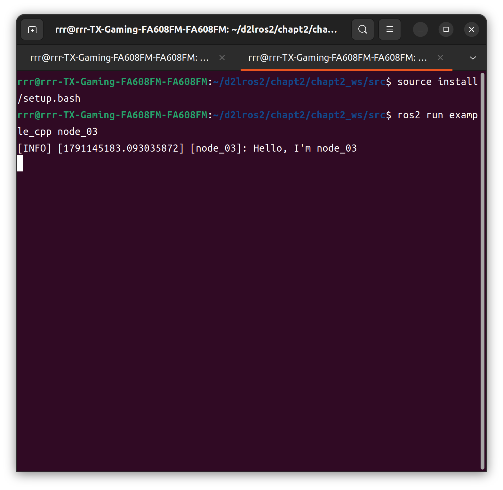

# ROS2 学习 -- Chapt_2

### 软件安装

- 官方自带的：
```bash
sudo apt install 软件名
```

- .deb 文件：这是一种安装包。下载后运行与上面一样
```bash
cd ~/Download
sudo apt install ./xxx.deb
```

- .AppImage 文件：不需要安装，只需要给权限就能自己运行：
```bash
cd ~/Downloads
chmod +x xxx.AppImage    # 赋执行权限。第一个x是真·x，但后面的表示软件名
./xxx.AppImage           # 运行
```

- .snap 文件：
```bash
sudo snap install 软件名
```

### 使用make编译Cpp文件

1. 在同目录下新建文件Makefile
2. 书写Makefile
```Makefile
build:
    g++ 文件名.cpp \
    # 后面是一堆文件地址。找起来有点麻烦。可合理运用vibe coding
    -lrclcpp -lrcutils
    -o node_name

clean:
    rm node_name
```
关于如何找到这些文件或库的地址，可以试试这么干：
先在ros的安装目录（`/opt/ros/humble/include/rclcpp`）寻找：
```bash
cd ~/opt/ros/humble/include/rclcpp

ls rclcpp/* | grep rclcpp.h
```
随后会返回这个目录下面所有带有`rclcpp.h`字眼的文件。找到文件之后（没找到退回上一级再试试。实在不行交给老肥鱼66），在Makefile下面加上`-I/opt/ros/humble/include/rclcpp`（反正就是-I 地址）
这类错误容易连环套娃。需要一直查，直到彻底清除错误`no such file or directory`为止。
对于错误`undifined reference to xxx`，在地址`/opt/ros/humble/lib`下面查找需要的动态链接库。最后`-L 库的地址`即可。

注意：Makefile里面**需要区分Tab和4个空格**。最好统一用Tab。

3. 创建节点
```bash
make build
```
`make clean`可以删除节点

4. 运行节点 `.\node_name`

### 使用Cmake编译

1. 写`CMakeLists.txt`文件
2. 在同级创建文件夹build。再`cd build`, `cmake ..`创建节点
3. `make`运行节点

**常用于第三方库。自己写的一般用colcon build**

### ROS2 常见命令

- 运行节点
```bash
ros2 run <package_name> <executable_name>
```

- 查看节点列表
```bash
ros2 node list
```

- 查看节点信息
```bash
ros2 node info <node_name>
```

- 重映射节点名称 （这里以画小海龟的那个节点为例）
```bash
ros2 run turtlesim turtlesim_node --ros-args --remap __node:=my_turtle
```

- 运行节点时设置参数
```bash
ros2 run example_parameters_rclcpp parameters_basic --ros-args -p rcl_log_level:=10
```

### 工作空间

一个工作空间下面包含了多个功能包，相当于一个文件夹/目录。
功能包，即存放节点的地方根据编译方式的不同分为三种类型：

- ament_python，适用于python程序
- cmake，适用于C++
- ament_cmake，适用于C++程序,是cmake的增强版

### 功能包

##### 获取方式

1. 安装获取。
```bash
sudo apt install ros-<version>-package_name
```

2. 利用colcon手动编译源码。见介绍colcon的部分。

##### 相关指令

- 创建功能包
```bash
ros2 pkg create <package-name>  --build-type  {cmake,ament_cmake,ament_python}  --dependencies <依赖名字>
```

- 列出可执行文件。
列出所有：
```bash
ros2 pkg executables
```
单独列出某一个：
```bash
ros2 pkg executables 功能包
```

- 列出所有的包
```bash
ros2 pkg list
```

- 输出某个包所在路径的前缀
```bash
ros2 pkg prefix  <package-name>
```

- 列出包的清单描述文件（.xml文件，用于记录这个包的名字，构建工具，编译信息，拥有者，干啥用的等信息）
```bash
ros2 pkg xml <package-name>
```

### Cpp版本最简单节点写法

```Cpp
#include "rclcpp/rclcpp.hpp"

class MyNode: public rclcpp::Node
{
    public:
        MyNode(std::string name) : Node(name)  // 构造函数
        {
            RCLCPP_INFO(this->get_logger(), "Hello, I'm %s", name.c_str());
            // 打印一句话
        }

    private:
        // ......
} 

int main(int argc, char **argv)
{
    rclcpp::init(argc, argc);

    auto my_node = std::make_shared<MyNode>("my_node"); // 创建节点
    rclcpp::spin(my_node);
    rclcpp::shutdown();
    
    return 0;
}

```

随后在bash运行
```bash
# 记得先cd到src上一级，或者说工作空间那一级
colcon build
source install/setup.bash
ros2 run <package_name> <executable_name>
```

注意，`my_robot_driver`指功能包名，对应`package.xml`里的`<name>`。而`my_node`指可执行文件名，通常是`CMakeLists.txt`里 `add_executable`定义的名字，或者Python包里`setup.py`配置的入口名。

运行如图


### Colcon进阶

|目的|命令|
|---|----|
|全量编译|`colcon build`|
|只编译一个包|`colcon build --packages-select my_pkg`|
|编译包及依赖|`colcon build --packages-up-to my_pkg`|
|编译多个包|`colcon build --packages-select pkg1 pkg2`|
|正则匹配|`colcon build --packages-select-regex "my_robot_.*"`|
|跳过包|`colcon build --packages-skip my_pkg`|
|只编译某目录|`colcon build --base-paths src/my_group`|
|Python 符号链接|`colcon build --symlink-install`|

有时候工作空间太大，不方便一次性全部编译，就要这样逐个编译。
