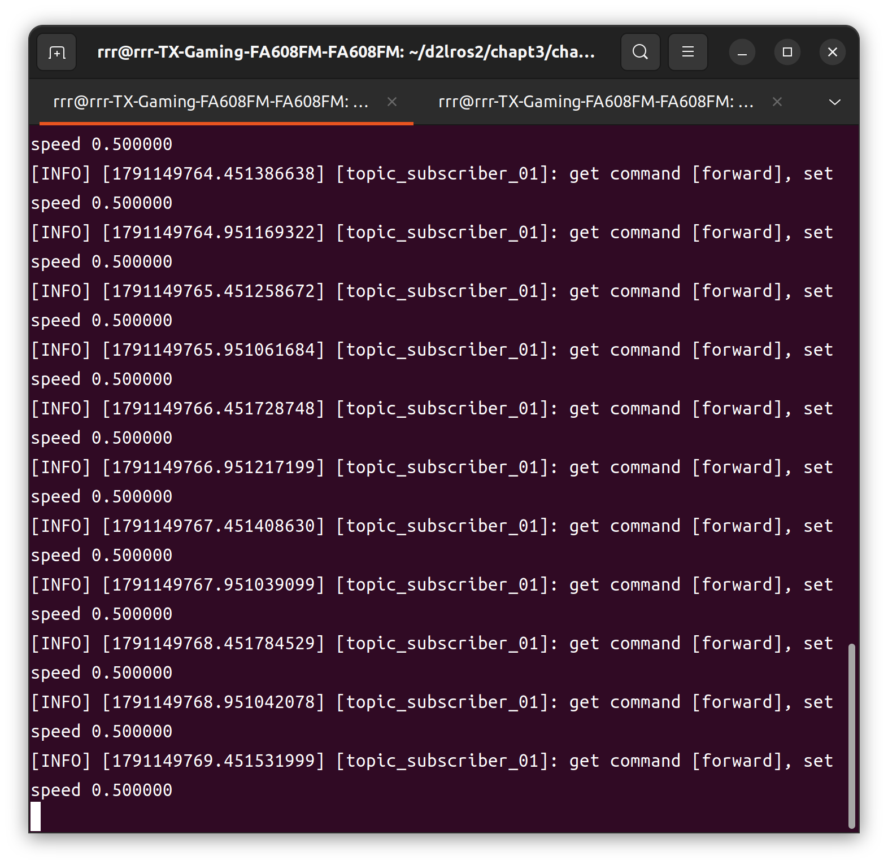
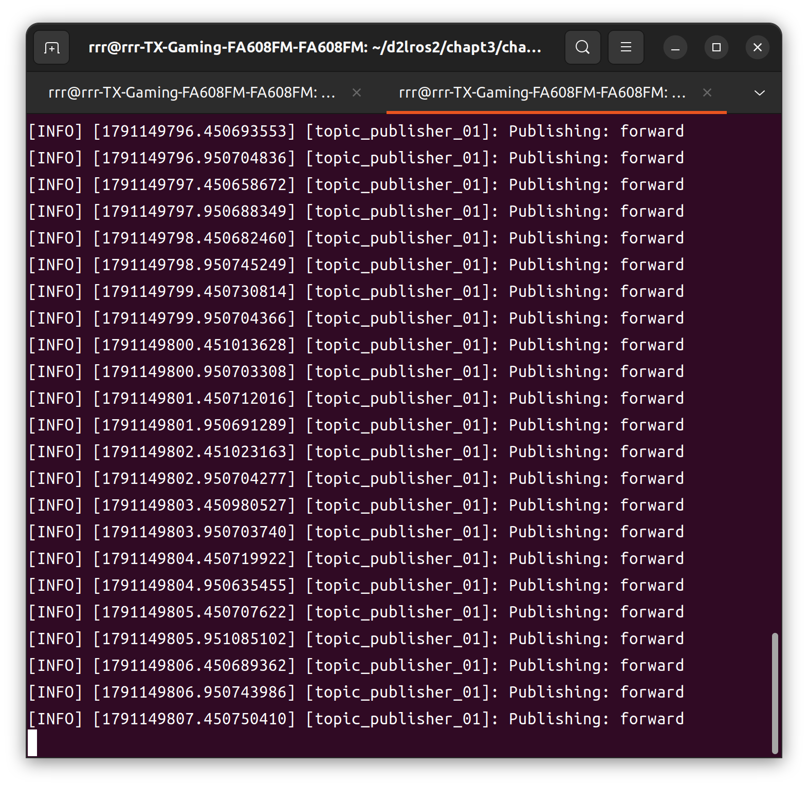

# ROS2 chapt3

### 话题

分为`publisher`和`subscriber`。pubulisher发布信息，subscriber接受信息。但是双方各不知道是谁在发送，对方是否收到。单向交流。

最简单的Cpp话题的代码如下

这是`publisher`的:
```cpp
#include "rclcpp/rcpcpp.hpp"
#include "rcl_msgs/msg/string.hpp"

class TopicPublisher01 : public rclcpp::Node
{
    public:
        // 构造函数,有一个参数为节点名称
        TopicPublisher01(std::string name) : Node(name)
        {
            RCLCPP_INFO(this->get_logger(), "%s节点已经启动.", name.c_str());

            command_publisher = this->create_publisher<std_msgs::msg::String>("command", 10);

            timer = this->create_wall_timer(
                std::chrono::milliseconds(500), 
                [this](){this->timer_callback();}
            );  // 计时器，500ms触发一次中断回调
        }

    private:
        // 声明节点
        rclcpp::Publisher<std_msgs::msg::String>::SharedPtr command_publisher;
        rclcpp::TimerBase::SharedPtr timer;

        void timer_callback()
        {
            std_msgs::msg::String message;  // 这是一个接口
            message.data = "forward";

            RCLCPP_INFO(this->get_logger(), "Publishing: %s", message.data.c_str());
            
            command_publisher->publish(message);
        }        
}

int main(int argc, char **argv)
{
    rclcpp::init(argc, argc);

    auto my_node = std::make_shared<TopicPublisher01>(
        "topic_publisher_01"
    ); // 创建节点
    rclcpp::spin(my_node);
    rclcpp::shutdown();
    
    return 0;
}
```

`subscriber`的如下：
```cpp
#include "rclcpp/rclcpp.hpp"
#include "std_msgs/msg/string.hpp"

class TopicSubscriber01 : public rclcpp::Node
{
    public:
        // 构造函数,有一个参数为节点名称
        TopicSubscriber01(std::string name) : Node(name)
        {
            RCLCPP_INFO(this->get_logger(), "I'm %s", name.c_str());
            command_subscriber = this->create_subscription<std_msgs::msg::String>(
                "command", 
                10, 
                [this](const std_msgs::msg::String::SharedPtr msg msg){
                    this->command_callback(msg);
                }
            );
        }

    private:
        rclcpp::Subscription<std_msgs::msg::String>::SharedPtr command_subscriber;

        void command_callback(const std_msgs::msg::String::SharedPtr msg)
        {
            double speed = 0.0f;
            if (msg->data == "forward")
            {
                speed = 0.5f;
            }
            RCLCPP_INFO(
                this->get_logger(), 
                "get command [%s], set speed %f", 
                msg->data.c_str(), 
                speed
            );
        } 
};

int main(int argc, char **argv)
{
    rclcpp::init(argc, argv);

    auto node = std::make_shared<TopicSubscriber01>(
        "topic_subscriber_01"
    );
    rclcpp::spin(node);
    rclcpp::shutdown();
    return 0;
}
```

由于存在调用`msg::String`，需要修改`CMakeLists`和`packages.xml`。分别如下：

```CMakeLists
find_package(rclcpp REQUIRED)
find_package(std_msgs REQUIRED)

add_executable(topic_publisher_01 src/topic_publisher_01.cpp)
ament_target_dependencies(topic_publisher_01 rclcpp std_msgs)
```

```xml
  <buildtool_depend>ament_cmake</buildtool_depend>

  <depend>rclcpp</depend>
  <depend>std_msgs</depend>

  <test_depend>ament_lint_auto</test_depend>
  <test_depend>ament_lint_common</test_depend>
```

成果如图：



